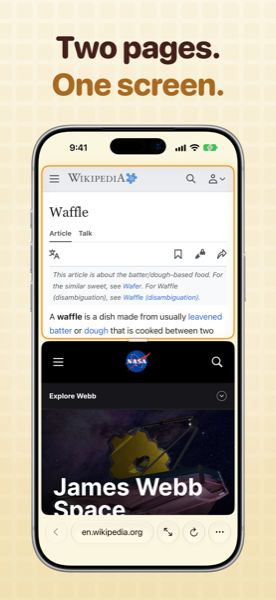
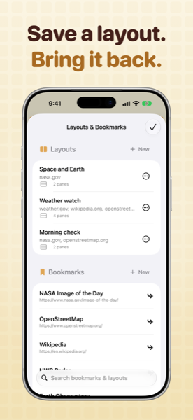
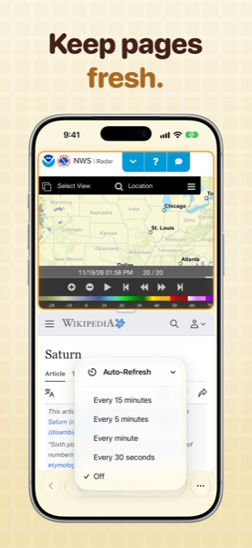
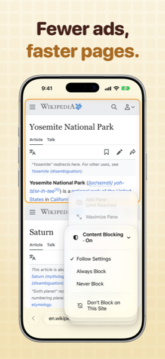

<p align="center">
  
</p>

<h1 align="center">Waffle</h1>

<p align="center"><strong>Keep several live pages on screen at once: two on iPhone, a grid on iPad, four on iPhone Duo.</strong></p>

<p align="center">
  <a href="https://apps.apple.com/us/app/waffle-browser/id6751783473">App Store</a> &middot;
  <a href="https://farsidesoftware.com/waffle">Product page</a> &middot;
  <a href="https://farsidesoftware.com/support">Support</a>
</p>

<p align="center">
  
  
  
  
</p>

Waffle is a web browser that puts pages next to each other instead of behind tabs. Every pane is a real, live browser, so mail, news, dashboards, and video can stay in view together. This repository is the current codebase, which is Waffle 2.0.

## What it does

- **A grid of live pages.** On iPad, every cell is a full browser with its own address bar, navigation, and reload. Add or remove rows and columns at any time.
- **Two panes on iPhone.** Stacked or side by side, with a draggable divider and a maximize button for focus.
- **Built for iPhone Duo.** Up to four panes on the unfolded display, and Desk Mode when half-folded.
- **Bookmarks and saved layouts.** Drag a bookmark onto any cell, and save a layout to bring every page back with one tap.
- **Content blocking.** Block ads, trackers, and cookie banners, with a separate setting for each page.
- **Auto-refresh.** Reload any page on a timer.
- **System integration.** iCloud sync, Siri and Shortcuts, Spotlight, Handoff, `waffle://` deep links, and full keyboard support.

Waffle is free to use, with no ads and no account. Syrup, a one-time purchase with Family Sharing and no subscription, unlocks larger grids, rearranging, pop-out windows, fullscreen cells, and presets on iPad, unlimited saved layouts on iPhone, and the third and fourth pane and Desk Mode on iPhone Duo. Waffle is available in English, Spanish, Canadian French, and Japanese.

## Platforms and requirements

- iPhone and iPad (iOS and iPadOS 26 or later), including iPhone Duo. It also runs on Mac and Apple Vision as a compatible iPad app.
- To build: Xcode 27 and an Apple Developer account for the iCloud (CloudKit) capability. The project is built against the iOS 27 SDK, and iOS 27-only APIs are behind availability checks.

## Building

1. Clone the repository and open `Waffle.xcworkspace`, not the bare `.xcodeproj`. It resolves the local package in `Packages/Waffle`, and there are no external dependencies.
2. Set your signing team and update the bundle identifier and the iCloud container identifier.
3. Build and run the `Waffle` scheme on an iPhone or iPad simulator or device.

The package builds and tests on the Mac host without a simulator:

```sh
cd Packages/Waffle && swift test
```

If `xcodebuild` reports a command-line-tools error, point `DEVELOPER_DIR` at your Xcode 27 install.

## Architecture

Waffle is a thin app target on top of an SPM umbrella package of layered modules. Dependencies point inward: features depend on the design system and core, data implements core's protocols, and core depends on nothing.

```
Waffle (app target, thin shell)
    └── WaffleComposition        SessionController (composition root) + RootView/MainView
            ├── WaffleFeature*   Grid · Sidebar · Settings · Onboarding · Syrup
            ├── WaffleServices   StoreManager (StoreKit 2) · review requester
            ├── WaffleData       SwiftData repositories · CloudKit store
            ├── WaffleDesignSystem  brand colors · button styles · error UI
            └── WaffleCore       models · domain logic · protocols · seams (pure)
```

- **Repositories and use-cases.** Views never touch SwiftData. Every read and write goes through a single-verb use-case with typed errors.
- **Grid state.** `GridModel` holds cells, selection, and pop-out state, and saves debounced snapshots so the grid restores on launch.
- **Graceful persistence.** CloudKit, then local-only, then in-memory.

`CLAUDE.md` has the module-by-module detail.

## Privacy

Your bookmarks and layouts are stored in your private iCloud container. No browsing history is sent to us or to third parties, and there is no analytics or tracking.

---

Made by [Farside Software LLC](https://farsidesoftware.com). Released under the MIT License, see [LICENSE](LICENSE).
